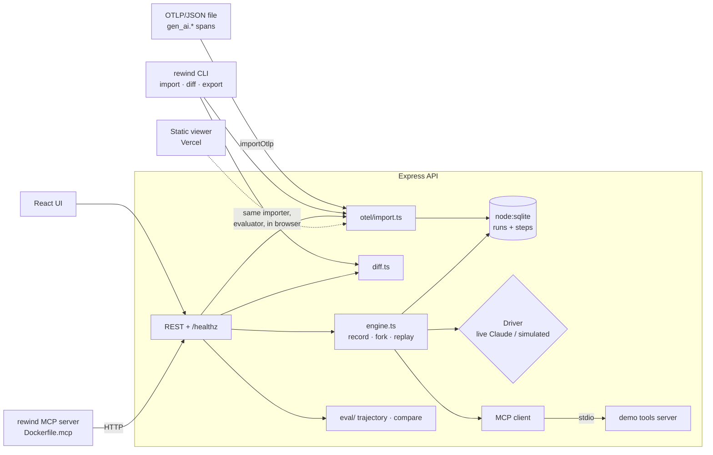
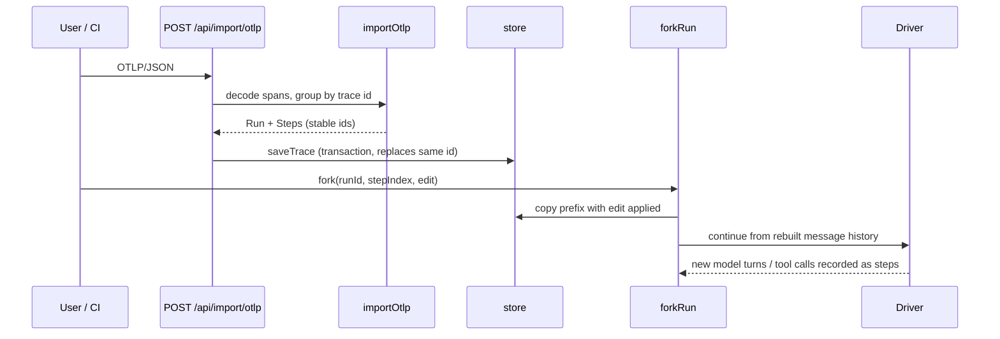

# Rewind design

## Problem
Agent observability tools show traces but do not let you act on them. When a run goes wrong you want to
(1) get the trace into one place regardless of which framework produced it, (2) change one thing and see
what happens next, and (3) see exactly where two runs stopped agreeing.

## Requirements
**Functional**
- Record runs as ordered steps (prompt, model turn, tool call); fork at any step with one edit; replay the future.
- Import OTLP/JSON traces following the OpenTelemetry GenAI semantic conventions as runs.
- `rewind diff A B`: first divergent step and per-step deltas; also in the REST API, MCP and the compare UI.
- Score runs against a trajectory spec (exact / in-order / any-order, precision/recall/F1, outcome checks).
- Free static viewer with bundled sample traces; full server via Docker.

**Non-functional**
- Free to run: no key needed (simulated agent); SQLite storage; static hosting for the demo.
- Deterministic imports (same input gives same ids) so re-importing is idempotent.
- Parents are never mutated by a fork. Small footprint: one Node process, no external services.

## Architecture

### Import and fork sequence

## Data model
`Run` (id, name, status, mode, `source?: 'otel'`, model, parent/fork lineage, metrics) and `Step`
(`prompt` | `llm_call` | `tool_call`), stored as JSON rows in SQLite (`runs`, `steps(run_id, idx)`).
A prefix of steps is losslessly an Anthropic-style message history (`buildMessages`), which is the replay primitive.

### OTel GenAI mapping
| OTel | Rewind |
|---|---|
| span with `gen_ai.operation.name` = chat / text_completion / generate_content | `llm_call` step |
| `execute_tool` span (`gen_ai.tool.name`, `.call.id`, `.call.arguments`, `.call.result`) | `tool_call`, linked to the model turn that requested the call id |
| `gen_ai.input.messages`, `gen_ai.output.messages`, `gen_ai.system_instructions` (or `gen_ai.*.message` / `gen_ai.choice` events) | prompt step, text and `tool_use` blocks |
| `gen_ai.usage.input_tokens` / `output_tokens`, response/request model | usage, model; cost only for models in the pricing table |
| root span / `gen_ai.agent.name` | run name |

## API contract
- `POST /api/import/otlp` body: OTLP/JSON. 201 `{runs}`; 422 if no GenAI spans; 400 on malformed input.
- `GET /api/diff?a=<run>&b=<run>` returns `{firstDivergence, steps[], totals[]}`.
- Existing: `/api/runs`, `/api/runs/:id`, `/api/runs/:id/fork`, `/api/runs/:id/evaluate`, `/api/compare`, `/api/health`; `/healthz` for probes.
- Every response carries `X-Request-Id`; one JSON log line per request.
- CLI: `rewind import|diff|export`; `diff` exits 1 when runs diverge (usable in CI), 0 when identical.

## Scaling path
Single node plus SQLite is the design point (thousands of runs). Next steps if needed: Postgres behind the
`store` interface, import as a streaming/batched job, indexed step search. Not built.

## Failure modes
| Failure | Mitigation |
|---|---|
| Instrumentation omits tool calls on the model span | importer synthesises the `tool_use` block from the tool span |
| Parallel tools finish out of order | steps are ordered by the model's requested order, not span end time |
| Unknown model has no price | cost recorded as 0 rather than guessed |
| Huge payload | body limit (`REWIND_MAX_BODY`, default 5 MB), write rate limit |
| Import of the same trace twice | deterministic ids; `saveTrace` replaces inside a transaction |
| Fork of an imported run needs tools Rewind does not have | the tool call returns an error step; the edit and history still replay |

## Security and privacy
Traces can contain prompts and tool output: treat imported files as sensitive. The public viewer is static; imports
stay in the browser tab. The server has no auth; deploy behind your own proxy if exposed. Containers run as non-root.
CodeQL and Dependabot are enabled.

## Decisions
- **ADR-1 index-aligned diff.** Diff aligns by step index: exact up to the first divergence, positional after. Cheaper
  and more predictable than sequence alignment; the first divergence is the useful signal.
- **ADR-2 one importer, two runtimes.** The importer is pure (no Node APIs) so the static viewer runs the same code as the server.
- **ADR-3 SQLite via `node:sqlite`.** No native build, zero ops; requires Node 24.
- **ADR-4 model span order over wall clock for tool grouping.** Wall-clock ties and parallelism make timestamps unreliable.

## Free-tier cost table
| Piece | Service | Cost |
|---|---|---|
| Static viewer | Vercel Hobby | 0 |
| CI, CodeQL, images | GitHub Actions / GHCR | 0 (public repo) |
| Full demo server | Render free (existing `render.yaml`) or local Docker | 0 |
| Agent | simulated model (no key) | 0 |
